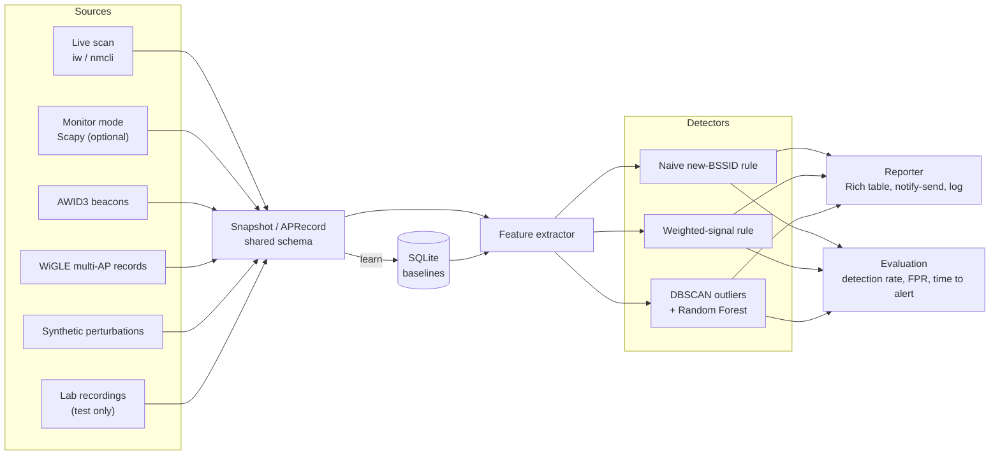

# TwinWatch

Passive evil twin Wi-Fi access point detector for Linux.

## Problem statement

A phone or laptop picks a Wi-Fi network by its name (SSID). An attacker can broadcast the same name, often with a stronger signal, and clients may join the fake access point (AP) instead of the real one. The attacker can then read or change unencrypted traffic and show fake login pages. Cafes, airports and campuses are typical targets, because open or shared-password networks give the client no strong proof of which AP it is talking to.

Existing defences do not fit a visitor's laptop:

- Enterprise wireless IDS (e.g. Aruba) protects the venue owner and needs the owner's equipment.
- Kismet's spoofing alert needs a hand-made MAC list per SSID and reports each check as a separate alert.
- EvilAP_Defender needs an Aircrack-ng card and MySQL, reports no accuracy figures, and includes a denial-of-service mode.
- Campus and office networks use many APs under one SSID, so a rule like "new MAC address means attack" raises constant false alarms.

## Purpose

TwinWatch runs on the user's own laptop and only listens. It:

1. **Learns** a fingerprint of a trusted network (BSSIDs, channel and band, security suite, vendor prefix, beacon interval, capabilities).
2. **Groups** the network's legitimate APs with DBSCAN, so a multi-AP network is one cluster and outliers stand out.
3. **Scores** every AP using the trusted SSID with a Random Forest classifier and reports a risk level (Safe, Suspicious, Likely evil twin) with the signals behind it.
4. **Compares** itself against two rule baselines (naive new-BSSID rule, weighted-signal rule) using detection rate, false-positive rate and time to alert.

It never sends deauthentication or attack frames and never inspects user traffic. It cannot catch a perfect clone that copies the BSSID and every parameter; for that case use WPA3, 802.1X or a VPN.

## Architecture



Every source is converted into the same `Snapshot` of `APRecord`s, so features and detectors do not depend on where a scan came from.

## Datasets

| Source | Use |
|---|---|
| AWID3 (Evil Twin + normal captures) | Training: labelled evil twin and benign beacons |
| WiGLE | Benign multi-AP structure for real SSIDs |
| Synthetic | Attack scenarios missing from AWID3, built by perturbing benign baselines |
| Own lab (hostapd on own devices) | Held-out test set only, 5–10 runs per scenario |

All data lives under `data/` (`raw/`, `processed/`, `lab/`) and is versioned with DVC on a private DagsHub repository, not in git. Git tracks only the small pointer files (`data/lab.dvc` and so on). Lab recordings include nearby networks' names and MAC addresses, so the DagsHub repository must stay private.

### Data with DVC and DagsHub

Put `DAGSHUB_NAME` and `DAGSHUB_TOKEN` in `.env` (see `.env.example`). After cloning, connect once and download the data:

```bash
.venv/bin/dvc remote modify origin --local auth basic
set -a; . ./.env; set +a
.venv/bin/dvc remote modify origin --local user "$DAGSHUB_NAME"
.venv/bin/dvc remote modify origin --local password "$DAGSHUB_TOKEN"
.venv/bin/dvc pull
```

The credentials go to `.dvc/config.local`, which DVC keeps out of git. After adding or changing data:

```bash
.venv/bin/dvc add data/lab
git add data/lab.dvc
git commit -m "data: new lab recordings"
.venv/bin/dvc push
```

Use the same for `data/raw` and `data/processed` once they exist. A new folder under `data/` also needs its own line in `.gitignore`.

### Converting AWID3

```bash
python -m twinwatch.datasets.awid3 data/raw/awid3/Evil_Twin.csv -o data/processed/awid3/evil_twin.jsonl
```

- Input is an AWID3 CSV or pcap. A pcap is read through `tshark`; a CSV is read directly and needs the tshark field-name columns `frame.time_epoch`, `wlan.fc.type_subtype`, `wlan.bssid`, `wlan.ssid` and `radiotap.channel.freq` (or `wlan_radio.frequency`). The converter names any missing column; then convert the matching pcap instead.
- Only beacons and probe responses are used. Frames are grouped into 10 s windows (`--window`), one snapshot per window, like one scan cycle.
- Labels: `Normal` becomes `benign`, `Evil_Twin` becomes `evil_twin`, and other AWID3 attack classes stay unlabelled. Pcaps carry no labels.
- The output is a normal recording, so `twinwatch replay` works on it.

### Downloading WiGLE data

Put your WiGLE API name and token (from https://wigle.net/account) in `.env`, copied from `.env.example`. `.env` is gitignored.

```bash
python -m twinwatch.datasets.wigle download --ssid CampusNet --bbox 31.40,31.60,74.20,74.45 -o data/raw/wigle/campusnet.json
python -m twinwatch.datasets.wigle convert data/raw/wigle/campusnet.json -o data/processed/wigle/campusnet.jsonl
```

- `--bbox` is `LAT1,LAT2,LON1,LON2`. Always bound the area: WiGLE limits searches per day, and a common SSID matches millions of networks. `--max-results` defaults to 1000.
- WiGLE keeps one record per BSSID, not scans over time. The converter groups an SSID's APs into ~110 m grid cells; each cell with 2+ APs becomes one snapshot, roughly what one laptop scan would see.
- WiGLE has no signal strength, key management or capability bits, and records with unknown channel or encryption are dropped.

### Generating synthetic scenarios

```bash
python -m twinwatch.datasets.synth data/processed/wigle/*.jsonl data/lab/benign_*.jsonl -o data/processed/synthetic.jsonl --seed 0
```

Each benign base (a WiGLE cell or a benign recording) becomes one session per scenario: 6 clean scans for the baseline, then 6 scans with the scenario's AP added.

| Scenario | Added AP | Label |
|---|---|---|
| `benign_steady` | none | benign |
| `benign_new_ap` | new BSSID with the network's vendor prefix and settings | benign |
| `same_security` | new BSSID, other vendor, same security, same channel as the strongest AP | evil_twin |
| `open_network` | same as above but open (no encryption) | evil_twin |
| `stronger_signal` | same security, 15–25 dB stronger than the strongest AP | evil_twin |
| `cloned_bssid` | the strongest AP's BSSID on a channel the network does not use | evil_twin |

- Half of the twins copy the real AP's beacon interval and capability bits (a careful attacker); the rest use hostapd defaults.
- A twin only gets fields its base has, so WiGLE-based twins have no capability bits or TSF either. WiGLE bases get simulated signal levels, flagged as `simulated_rssi` in each snapshot's metadata.
- Sessions are tagged in snapshot metadata (`session`, `scenario`, `learn_scans`). Synthetic data is for training only; it measures nothing about real attacks.

## Install

Tested on Ubuntu with Python 3.12. Kali works with the same packages.

### System packages

| Package | Provides | Needed for |
|---|---|---|
| `python3`, `python3-venv`, `python3-pip` | Python 3.10+ and virtual environments | Everything |
| `git` | Version control | Cloning and committing |
| `iw` | `iw dev <if> scan` | Preferred scanner: dBm signal, beacon interval, capability bits, TSF |
| `network-manager` | `nmcli` | Fallback scanner, and triggering rescans without root |
| `libnotify-bin` | `notify-send` | Desktop alerts in `twinwatch watch` |
| `tshark` | Command-line Wireshark | Extracting beacon fields from AWID3 pcaps |
| `wireshark` | Wireshark GUI | Verifying lab frames before a session counts |
| `hostapd`, `dnsmasq` | Software AP and DHCP | Lab only, on the second laptop acting as the test twin |

```bash
sudo apt update
sudo apt install python3 python3-venv python3-pip git iw network-manager libnotify-bin tshark wireshark
```

On the lab laptop that plays the twin AP only:

```bash
sudo apt install hostapd dnsmasq
```

During the `tshark`/`wireshark` install, answer "No" to letting non-root users capture packets unless you need live captures without `sudo`. TwinWatch only reads pcap files with `tshark`.

Without `iw`, TwinWatch falls back to `nmcli`, which lacks beacon interval, capability bits and TSF.

### Python packages

| Package | Install group | Needed for |
|---|---|---|
| `rich` | core | Terminal tables and output |
| `numpy`, `scikit-learn` (≥1.4) | core | DBSCAN clustering, Random Forest |
| `pandas`, `matplotlib` | `eval` | Evaluation tables and charts |
| `scapy` | `monitor` | Optional monitor-mode beacon capture |
| `pytest` | `dev` | Test suite |

```bash
python3 -m venv .venv
.venv/bin/pip install -e '.[eval,monitor,dev]'
```

Use `.[dev]` alone for the tool and tests without the evaluation and monitor-mode extras.

### Hardware

- Any Linux-supported Wi-Fi card works for managed-mode scans.
- Optional: monitor mode for per-beacon TSF checks. Many built-in cards support it (check `iw list` for `monitor` under "Supported interface modes"); a USB adapter (Atheros AR9271 or Ralink RT5370) keeps the laptop's main connection up while capturing.

## Usage

| Command | What it does |
|---|---|
| `twinwatch scan [--ssid S]` | Scan once and list APs |
| `twinwatch learn --ssid S` | Learn the trusted baseline (6 scans, 10 s apart) and save it to SQLite. `--force` replaces an existing one |
| `twinwatch watch --ssid S` | Scan every 15 s, show a risk table, raise desktop alerts and log them |
| `twinwatch record -o FILE` | Record scans to JSON Lines for datasets and replay |
| `twinwatch replay FILE` | Run a detector over a recording and count verdicts per label |

```bash
twinwatch learn --ssid CampusNet
twinwatch watch --ssid CampusNet --detector weighted
twinwatch record -o data/lab/open_run01.jsonl --ssid CampusNet --scenario open --evil 02:00:00:aa:bb:cc --count 30
twinwatch replay data/lab/open_run01.jsonl --learn-scans 5 --detector naive
```

- Learn only on a network you already trust: a baseline learned next to an attacker trusts the attacker.
- `--detector` is `naive` (any new BSSID is an attack), `weighted` (hand-weighted signals) or `ml` (Random Forest; needs a trained model, `--model`, default `models/twinwatch_rf.joblib`).
- `--evil BSSID@FREQ` labels a twin that clones the real BSSID on another frequency.
- `replay --learn-scans N` builds the baseline from the first N snapshots of the file instead of the database.
- Baselines live in `~/.local/share/twinwatch/twinwatch.db`; alerts are logged to `~/.local/share/twinwatch/alerts.log`.

### Risk levels

Each AP of the trusted SSID gets a score from 0 to 1: Safe below 0.4, Suspicious from 0.4, Likely evil twin from 0.75. The table lists the signals that fired:

| Signal | Meaning |
|---|---|
| `new_bssid` | BSSID not in the baseline |
| `oui_change` | Vendor prefix not used by any baseline AP |
| `security_downgrade` | Weaker security than the baseline (e.g. WPA2 to open) |
| `security_mismatch` | Different security protocol or key management |
| `channel_jump` | Known BSSID on a frequency it never used (cloned BSSID) |
| `channel_unseen` | Frequency no baseline AP used |
| `signal_jump` | Signal over 10 dB stronger than expected |
| `beacon_mismatch` | Beacon interval differs from the baseline |
| `capability_mismatch` | Capability bits differ from the baseline |
| `cluster_outlier` | Device fingerprint not within reach of any DBSCAN cluster of trusted APs (ML detector only) |
| `tsf_anomaly` | The AP's TSF timestamp went backwards between its beacons: two devices share the BSSID on one channel (monitor mode and AWID3 only; ML detector only) |

### Monitor mode (optional)

`--backend monitor` captures beacons with Scapy instead of asking the driver for scan results. It only listens. Each scan hops over the common 2.4 and 5 GHz channels (about 9 s) and merges each AP's beacons. Seeing every beacon lets it catch a twin that clones the real AP's BSSID on the same channel: the two devices' TSF clocks interleave, so the TSF goes backwards. Managed-mode scans merge the two into one entry and cannot see this.

It needs root, `iw`, the `monitor` extra (Scapy) and an interface in monitor mode:

```bash
sudo iw dev wlp4s0 interface add mon0 type monitor
sudo ip link set mon0 up
sudo .venv/bin/twinwatch scan -i mon0 --backend monitor --ssid HomeNet
sudo iw dev mon0 del
```

If the card is also connected to Wi-Fi, it is pinned to that channel (`Device or resource busy`). Capture then stays on the connected channel for the whole scan and says so: APs on other channels are not seen, but a twin cloning the connected AP on its channel still is. To hop all channels, disconnect the managed interface or use a second USB adapter. `Too many open files (-23)` from `interface add` means `mon0` already exists. `python -m twinwatch.scan.monitor --help` shows the same steps.

### DBSCAN grouping

The trusted APs are clustered by device fingerprint: vendor prefix, security profile, beacon interval and capability bits. The distance is the mean of per-attribute differences, from 0 (identical) to 1, and attributes a source lacks are skipped. A new AP more than `eps` = 0.2 from every trusted AP is an outlier, so a twin that differs only in vendor prefix (distance 0.25) is caught. Every trusted AP anchors its own cluster (`min_samples` = 1), so a router plus an extender from another vendor is two clusters with no false outlier. Re-tune `eps` on labelled recordings with:

```bash
python -m twinwatch.cluster tune data/processed/synthetic.jsonl data/lab/*.jsonl
```

A cloned BSSID shares the real AP's vendor prefix and stays inside the cluster; the `channel_jump` signal covers it.

### Training the ML detector

```bash
python -m twinwatch.evaluation.train data/processed/synthetic*.jsonl data/processed/awid3/*.jsonl data/lab/benign_*.jsonl
```

- Every labelled AP seen after a session's baseline becomes one row of the 12 signals; a Random Forest (300 trees, balanced classes) learns evil twin vs benign.
- Cross-validation groups rows by origin (source recording and SSID), never by session or row, because synthetic sessions from one source share its devices. The table compares the out-of-fold ML scores with the naive and weighted rules on the same rows, and reports the synthetic share of the data.
- The model is saved with the signal list it was trained on, so a model from an older signal set is refused. Explanations list the fired signals by feature importance.
- `models/` is gitignored; track it with DVC like the data. Never train on the lab attack sessions: they are the test set.

## Project layout

```
twinwatch/
  model.py        shared schema: APRecord, Snapshot
  recording.py    JSONL snapshot recordings
  scan/           iw and nmcli parsers, monitor-mode capture (Scapy), scan runner
  beacons.py      per-beacon suite decoding and merging (monitor mode, AWID3)
  baseline.py     baseline fingerprint of a trusted SSID
  report.py       risk tables, desktop alerts, alert log
  cli.py          twinwatch command
  store.py        SQLite baseline store
  features.py     signals per AP against the baseline
  cluster.py      DBSCAN grouping of trusted APs, eps tuning
  detectors/      naive and weighted rules, Random Forest (ml)
  datasets/       AWID3 and WiGLE converters, synthetic scenario generator
  evaluation/     train.py (ML training); metrics (planned)
tests/            pytest suite with recorded scan fixtures
data/lab/         lab recordings (stored on DagsHub, not in git)
```

## Tests

```bash
.venv/bin/pytest
```

## Safety

All attack scenarios run only on the team's own router and laptops. Scanning public spaces is passive beacon listening only. The hostapd test AP is a lab instrument; this repository ships no evil twin kit.
