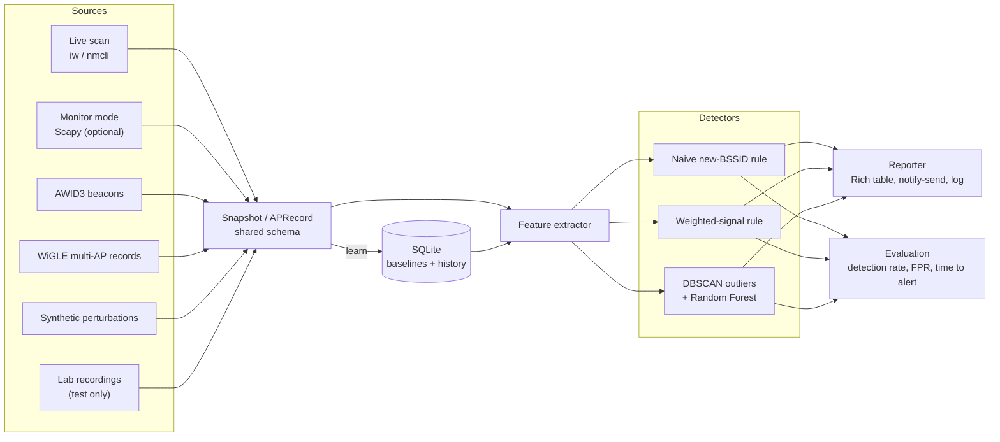

# TwinWatch

Passive evil twin Wi-Fi access point detector for Linux.

## Problem statement

A phone or laptop picks a Wi-Fi network by its name (SSID). An attacker can broadcast the same name, often with a stronger signal, and clients may join the fake access point (AP) instead of the real one. The attacker can then read or change unencrypted traffic and show fake login pages. Cafes, airports and campuses are typical targets, because open or shared-password networks give the client no strong proof of which AP it is talking to.

Existing defences do not fit a visitor's laptop:

- Enterprise wireless IDS (e.g. Aruba) protects the venue owner and needs the owner's equipment.
- Kismet's spoofing alert needs a hand-made MAC list per SSID and reports each check as a separate alert.
- EvilAP_Defender needs an Aircrack-ng card and MySQL, reports no accuracy figures, and includes a denial-of-service mode.
- Campus and office networks use many APs under one SSID, so a rule like "new MAC address means attack" raises constant false alarms.

## Purpose

TwinWatch runs on the user's own laptop and only listens. It:

1. **Learns** a fingerprint of a trusted network (BSSIDs, channel and band, security suite, vendor prefix, beacon interval, capabilities).
2. **Groups** the network's legitimate APs with DBSCAN, so a multi-AP network is one cluster and outliers stand out.
3. **Scores** every AP using the trusted SSID with a Random Forest classifier and reports a risk level (Safe, Suspicious, Likely evil twin) with the signals behind it.
4. **Compares** itself against two rule baselines (naive new-BSSID rule, weighted-signal rule) using detection rate, false-positive rate and time to alert.

It never sends deauthentication or attack frames and never inspects user traffic. It cannot catch a perfect clone that copies the BSSID and every parameter; for that case use WPA3, 802.1X or a VPN.

## Architecture



Every source is converted into the same `Snapshot` of `APRecord`s, so features and detectors do not depend on where a scan came from.

## Datasets

| Source | Use |
|---|---|
| AWID3 (Evil Twin + normal captures) | Training: labelled evil twin and benign beacons |
| WiGLE | Benign multi-AP structure for real SSIDs |
| Synthetic | Attack scenarios missing from AWID3, built by perturbing benign baselines |
| Own lab (hostapd on own devices) | Held-out test set only, 5–10 runs per scenario |

Raw data lives in `data/raw/` and is not committed. Lab recordings live in `data/lab/`.

## Install

Tested on Ubuntu with Python 3.12. Kali works with the same packages.

### System packages

| Package | Provides | Needed for |
|---|---|---|
| `python3`, `python3-venv`, `python3-pip` | Python 3.10+ and virtual environments | Everything |
| `git` | Version control | Cloning and committing |
| `iw` | `iw dev <if> scan` | Preferred scanner: dBm signal, beacon interval, capability bits, TSF |
| `network-manager` | `nmcli` | Fallback scanner, and triggering rescans without root |
| `libnotify-bin` | `notify-send` | Desktop alerts in `twinwatch watch` |
| `tshark` | Command-line Wireshark | Extracting beacon fields from AWID3 pcaps |
| `wireshark` | Wireshark GUI | Verifying lab frames before a session counts |
| `hostapd`, `dnsmasq` | Software AP and DHCP | Lab only, on the second laptop acting as the test twin |

```bash
sudo apt update
sudo apt install python3 python3-venv python3-pip git iw network-manager libnotify-bin tshark wireshark
```

On the lab laptop that plays the twin AP only:

```bash
sudo apt install hostapd dnsmasq
```

During the `tshark`/`wireshark` install, answer "No" to letting non-root users capture packets unless you need live captures without `sudo`. TwinWatch only reads pcap files with `tshark`.

Without `iw`, TwinWatch falls back to `nmcli`, which lacks beacon interval, capability bits and TSF.

### Python packages

| Package | Install group | Needed for |
|---|---|---|
| `rich` | core | Terminal tables and output |
| `numpy`, `scikit-learn` (≥1.4), `pandas`, `matplotlib` | `ml` | DBSCAN, Random Forest, evaluation tables and charts |
| `scapy` | `monitor` | Optional monitor-mode beacon capture |
| `pytest` | `dev` | Test suite |

```bash
python3 -m venv .venv
.venv/bin/pip install -e '.[ml,monitor,dev]'
```

Use `.[dev]` alone for the scanner and tests without the ML stack.

### Hardware

- Any Linux-supported Wi-Fi card works for managed-mode scans.
- Optional: a USB adapter with monitor mode (Atheros AR9271 or Ralink RT5370 chipset) for TSF timestamp features. A second adapter keeps the laptop's main connection up while capturing.

## Usage

```bash
twinwatch scan --ssid CampusNet
twinwatch record -o data/lab/open_run01.jsonl --ssid CampusNet --scenario open --evil 02:00:00:aa:bb:cc --count 30
```

`--evil BSSID@FREQ` labels a twin that clones the real BSSID on another frequency.

## Project layout

```
model.py          shared schema: APRecord, Snapshot
recording.py      JSONL snapshot recordings
scan/             iw and nmcli parsers, scan runner, monitor mode (planned)
report.py         terminal output
cli.py            twinwatch command
store.py          baselines (planned)
features.py       feature extraction (planned)
cluster.py        DBSCAN (planned)
detectors/        naive, weighted, ml (planned)
datasets/         AWID3, WiGLE, synthetic converters (planned)
evaluation/       training and metrics (planned)
tests/            pytest suite with recorded scan fixtures
data/lab/         lab recordings
```

## Tests

```bash
.venv/bin/pytest
```

## Safety

All attack scenarios run only on the team's own router and laptops. Scanning public spaces is passive beacon listening only. The hostapd test AP is a lab instrument; this repository ships no evil twin kit.
